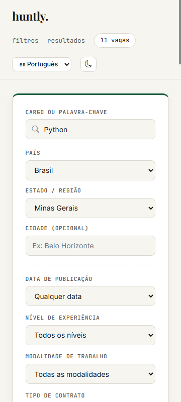
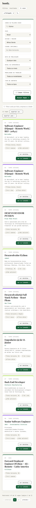
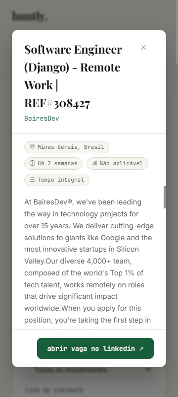
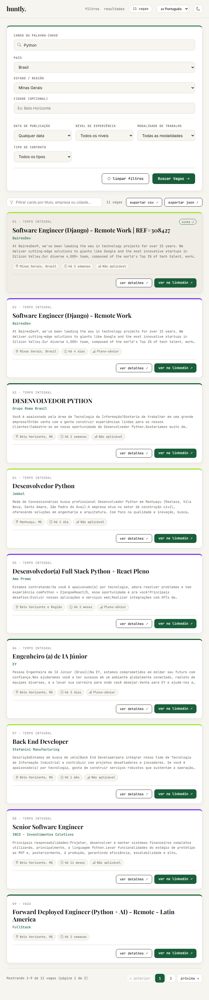
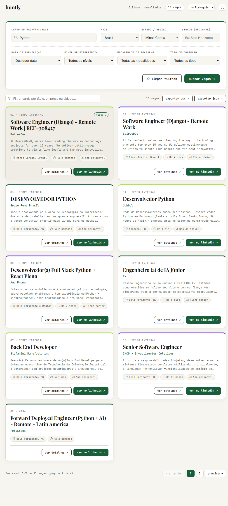
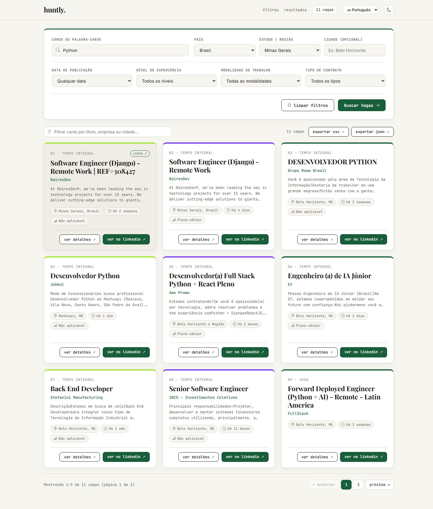
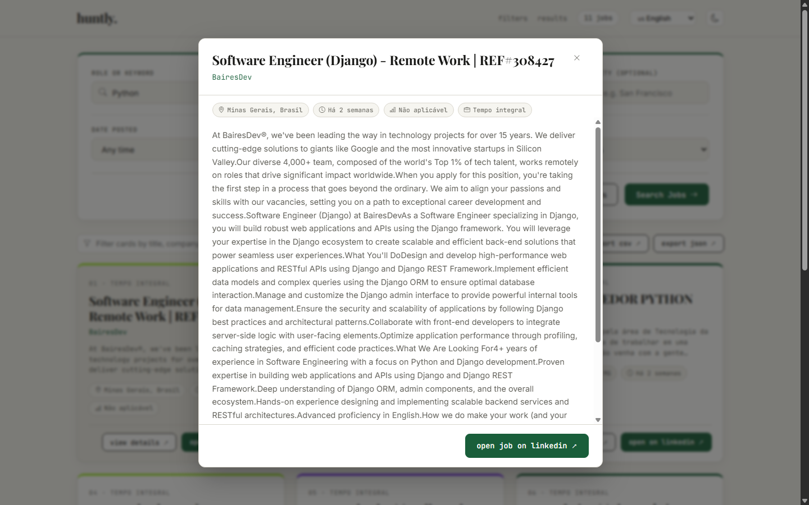

# Auditoria Visual, Responsividade e Idiomas (i18n) — Huntly (`@frontend`)

**Branch analisada:** `melhorias`  
**Data da auditoria:** 2026-11-20  
**Escopo:** Inspeção em navegador headless (Google Chrome `157.0.8103.80`) acessando o servidor local `http://127.0.0.1:5000` com busca real (`Python`, `Brasil` → `Minas Gerais`, **11 vagas carregadas** e paginação ativa em 2 páginas).

---

## 1. Linha de Base (`pytest`) e Ambiente de Execução

- **Linha de base (`python -m pytest -v`):** **`17 passed, 348 warnings in 0.92s`** (`tests/test_app.py`: 9; `tests/test_scraper.py`: 8).
- **Estado inicial carregado:** `lang="pt-BR"`, título `"huntly — buscador de vagas linkedin"`, contador `"0 vagas"`.
- **Busca real executada para popular cards e paginação:** `keywords="Python"`, `country="Brasil"`, `state="Minas Gerais"` → **11 vagas** coletadas (`9` cards exibidos na página 1 + `#pagination-bar` visível).
- **Erros de console observados:** `1` erro de recurso HTTP 404 (`Failed to load resource: the server responded with a status of 404 (NOT FOUND)`), decorrente da ausência de `<link rel="icon">` / rota `/favicon.ico` em `templates/index.html:4-15` *(hipótese de URI `/favicon.ico`, 404 confirmado no log do navegador)*. Nenhum erro de JavaScript em runtime.

---

## 2. Auditoria de Responsividade (`360px`, `768px`, `1024px` e `1440px`)

### 2.1 Tabela Resumo das Medições

| Viewport | `innerWidth` | `scrollWidth` | Overflow Horizontal | Colunas Cards | Altura Total (`scrollHeight`) | Status | Principais Achados |
| --- | ---: | ---: | --- | ---: | ---: | --- | --- |
| **360×800** (Mobile) | 360 px | 360 px | Não (`0` elementos) | 1 | 4.956 px | Atenção | Navbar sticky com `157.9px` (3 linhas visuais); botões de ação do form/cards e exportação quebrando desalinhados; modal estreito (`312px`) com título grande quebrando em 4 linhas |
| **768×1024** (Tablet) | 768 px | 768 px | Não (`0` elementos) | 1 | 3.669 px | Atenção | `@media (max-width: 768px)` (`static/styles.css:727-741`) colapsa tudo para 1 coluna: campos de localização gigantes (`666.8px`), cards em coluna única longa e `.filters-grid` com 3+1 (1 campo órfão na 2ª linha) |
| **1024×768** (Desktop pequeno) | 1024 px | 1009 px | Não (`0` elementos) | 2 | 2.228 px | Atenção | Grid de 9 cards em 2 colunas deixa 1 card órfão na 5ª linha; os 3 campos de localização ficam espremidos em `164.9px` cada (`static/styles.css:181-197`) |
| **1440×900** (Desktop amplo) | 1440 px | 1425 px | Não (`0` elementos) | 3 | 1.676 px | OK | Centralizado (`1152px` úteis dentro de `max-width: 1200px`), grid 3×3 alinhado, filtros em 1 linha e paginação em 1 linha |

---

### 2.2 Detalhamento por Viewport

#### 1) Mobile — `360×800`

- **Rolagem horizontal:** `scrollWidth = 360px` (`0` elementos extrapolando `innerWidth` e `0` `textOverflows` detectados).
- **Navbar sticky alta (`157.9px`) em `static/styles.css:58-93`:**
  - `.navbar-inner` (`flex-wrap: wrap`) e `.navbar-links` (`flex-wrap: wrap`) quebram em **3 linhas visuais** (marca `huntly.` na 1ª, links + pill na 2ª, seletor de idioma + tema na 3ª), ocupando quase 20% dos `800px` verticais mesmo durante a rolagem.
- **Botões do formulário (`static/styles.css:275-284`):**
  - `.form-actions` usa `justify-content: flex-end; flex-wrap: wrap`, fazendo `limpar filtros` (`173.9px`) e `Buscar Vagas` (`157.8px`) empilharem em 2 linhas encostadas à direita com ~85–100px ociosos à esquerda (`360px_full.png`).
- **Toolbar de resultados (`static/styles.css:417-452`):**
  - `.export-buttons` quebra entre `11 vagas` + `exportar csv ↗` na linha 1 e `exportar json ↗` isolado na linha 2 (`360px_full.png`).
- **Ações nos cards (`static/styles.css:594-602`):**
  - `.card-actions` quebra `ver detalhes ↗` e `ver no linkedin ↗` em 2 linhas alinhadas à direita (`360px_full.png`).
- **Modal em 360px (`static/styles.css:658-725`):**
  - `.modal-backdrop` (`padding: 1.5rem`) + paddings internos de `1.5rem` reduzem a área útil de texto; no card medido (`312×680px`), `#modal-title` (`font-size: 1.45rem`, `static/styles.css:694`) quebrou em 4 linhas grandes (`360px_modal.png`).
- **Risco de quebra de palavras longas (`static/styles.css:546-572, 692-718`):**
  - `.card-title`, `.card-subtitle`, `.card-excerpt`, `.modal-header h3` e `.modal-body` não definem `overflow-wrap: anywhere` / `word-break: break-word`; URLs ou tokens longos sem espaço na descrição/título podem causar overflow em `360px`.
  - *Nota adicional visível em `360px_modal.png` e nos cards:* descrições extraídas pelo scraper (`scraper.py:295, 304`) concatenam parágrafos adjacentes sem espaço (`"Valley.Our"`, `"empresa?Então"`, `"um(a)Back End Developerpara"`) devido a `get_text(strip=True)` sem `separator`.

#### 2) Tablet — `768×1024`

- **Rolagem horizontal:** `scrollWidth = 768px` (zero overflow).
- **Breakpoint `@media (max-width: 768px)` muito agressivo (`static/styles.css:727-741`):**
  - Em `768px` exatos, o breakpoint força `.primary-inputs-grid`, `.location-selects-grid` e `.results-grid` para `1fr`:
    - Os 3 campos de localização (`País`, `Estado / Região`, `Cidade`) ficam empilhados com `666.8px` de largura cada (`768px_full.png`), alongando o formulário.
    - Os 9 cards caem em **1 única coluna** de `720px` de largura (com apenas 2–3 linhas curtas por card e grande espaço branco horizontal), elevando a página para `3.669px` de altura quando caberiam confortavelmente **2 colunas** (`~350px` por card).
- **Grid de filtros avançados assimétrico (`static/styles.css:199-203`):**
  - `.filters-grid` usa `repeat(auto-fit, minmax(185px, 1fr))`, criando **3 colunas na 1ª linha e 1 campo órfão (`Tipo de contrato`) na 2ª linha** (`filtersGrid.rowCount = 2`, `768px_full.png`). Com `2` colunas em tablet (`repeat(2, 1fr)`), os 4 filtros formariam um grid simétrico 2×2.

#### 3) Desktop Pequeno — `1024×768`

- **Rolagem horizontal:** `scrollWidth = 1009px` para `innerWidth = 1024px` (zero overflow).
- **Campos de localização estreitos (`static/styles.css:181-197`):**
  - `.primary-inputs-grid` (`1fr 1.4fr`) divide a largura com `.location-selects-grid` (`repeat(3, 1fr)`), deixando `#country`, `#state` e `#city` com **`164.9px` cada** (`1024px_full.png`). Nomes longos de estados/países ou rótulos em idiomas mais verbosos (ex.: Alemão/Russo) ficam próximos do limite de truncamento dentro do `<select>`.
- **Grid de cards em 2 colunas (`static/styles.css:487-491`):**
  - `.results-grid` (`minmax(330px, 1fr)`) renderiza 2 colunas (`470.5px` cada); como `ITEMS_PER_PAGE = 9` (`static/script.js:171`), a página exibe 4 pares + **1 card órfão na 5ª linha** (`1024px_full.png`).

#### 4) Desktop Amplo — `1440×900`

- **Rolagem horizontal:** `scrollWidth = 1425px` para `innerWidth = 1440px` (zero overflow).
- **Layout geral:** Container centralizado (`1152px` úteis dentro de `max-width: 1200px`, `static/styles.css:67, 159`), `.filters-grid` em 1 linha com 4 colunas, `.location-selects-grid` em 3 colunas de `202.1px`, `.results-grid` em 3×3 (`370.7px` por card), toolbar e paginação alinhadas em 1 linha cada (`1440px_full.png`).
- **Detalhe visual do seletor de idioma (`templates/index.html:28-35`):** Em ambiente Windows/Chrome sem fallback de emoji colorido para bandeiras regionais, as opções do `#lang-select` renderizam os códigos regionais (`BR Português`, `US English`), embora isso seja limitação de fonte do SO.

---

## 3. Auditoria de Idiomas (i18n)

Teste executado alternando `#lang-select` para **`en` (`🇺🇸 English`)** em `1440×900` com resultados e modal abertos.

### 3.1 Separação Obrigatória: Textos de Interface vs Conteúdo Original das Vagas

Conforme `.agents/rules/huntly.md:24`:
> *100% da interface (rótulos, datas, selects, mensagens, erros) segue o idioma escolhido, sem resquícios de outro idioma. Título e descrição das vagas permanecem no idioma original do LinkedIn.*

#### A. Textos de INTERFACE que NÃO mudam de idioma (devem ser 100% traduzidos)

| # | Origem (`arquivo:linha`) | Evidência observada em `lang="en"` | Impacto nos 8 idiomas |
| --- | --- | --- | --- |
| 1 | **Países no `<select id="country">`** (`static/script.js:36-110, 161-166, 238-243`) | `#country` manteve `"Brasil"`, `"Portugal"`, `"United States"`, `"Canada"`, `"United Kingdom"`, `"Germany"`, `"Spain"`, `"Ireland"` sem tradução (`i18n_en.png`). | Mistura PT (`"Brasil"`) com EN (`"United States"`, `"Germany"`, `"Spain"`) em todos os idiomas. |
| 2 | **Datas relativas das vagas (`job.time`)** (`scraper.py:25, 267, 305`; `static/script.js:624, 670`) | Todos os cards e o modal mostraram `"Há 2 semanas"`, `"Há 4 dias"`, `"Há 1 dia"`, `"Há 2 meses"`, `"Há 3 dias"`, `"Há 1 mês"`, `"Há 11 meses"` em português (`i18n_en.png`, `i18n_en_modal.png`). | Datas ficam presas em PT-BR por causa de `Accept-Language: pt-BR`. |
| 3 | **Metadados estruturados da vaga (`Tipo de emprego` e `Nível de experiência`)** (`scraper.py:25, 308-312`; `static/script.js:601, 625-627, 671-676`) | Kicker mostrou `"01 · Tempo integral"` (PT) e badges mostraram `"Não aplicável"`, `"Pleno-sênior"`, `"Tempo integral"` no card e no modal (`i18n_en.png`, `i18n_en_modal.png`). | Chaves lidas apenas em PT e valores exibidos crus sem dicionário i18n. |
| 4 | **Mensagens de progresso/status do backend** (`state.py:20, 39, 51`; `scraper.py:344, 360, 391, 405, 442, 448, 451`; `static/script.js:699`) | Durante a coleta, `.status-text` exibiu `"Obtendo detalhes: 11/40 (11 vagas)"` fixo em PT. | Toda barra de progresso e mensagem de conclusão/vazio sai em PT em qualquer idioma. |
| 5 | **Mensagens de erro e feedback da API** (`app.py:32, 36, 44, 52, 58, 74, 82, 95, 118, 123, 132, 139, 163, 203`; `static/script.js:394, 408, 416`) | `#feedback-banner` imprime diretamente `payload.error` / `data.status_message` em PT (ex.: `"Uma busca de vagas já está em andamento."`). | Erros de validação e comunicação com o servidor aparecem em PT mesmo em EN/ES/FR/IT/DE/RU/ZH. |
| 6 | **Sugestões de cargos no `<datalist id="it-role-suggestions">`** (`templates/index.html:57-87`) | As 29 sugestões permaneceram em PT (`"Desenvolvedor Full Stack"`, `"Engenheiro de Software"`, `"Estágio em TI"`, etc.). | Autocomplete de cargos ignora o seletor de idioma. |
| 7 | **Atributos `aria-label` fixos no HTML** (`templates/index.html:27, 37, 46, 199, 225, 237`) | `#theme-toggle-btn` (`"Alternar tema"`), `#filtros` (`"Filtros de Busca"`), `#resultados` (`"Resultados da Busca"`), `#pagination-bar` (`"Paginação de resultados"`), `#close-modal-btn` (`"Fechar"`), `#lang-select` (`"Language"`). | Acessibilidade/leitores de tela ficam em PT/EN misturados. |
| 8 | **Textos iniciais do HTML antes do JS** (`templates/index.html:25, 209, 234`) | `"0 vagas"` (`#navbar-results-count`, `#results-count-text`) e `"Título da Vaga"` (`#modal-title`). | Flash inicial em PT antes de `applyLanguage()` rodar. |
| 9 | **Troca de idioma sem re-traduzir modal/status/banner abertos** (`static/script.js:145-169`) | `applyLanguage()` não atualiza `#job-modal` aberto nem `#status-section`/`#feedback-banner` ativos. | Mudar o idioma com o modal aberto deixa o modal parcialmente no idioma anterior. |
| 10 | **Nome do arquivo exportado** (`app.py:206`) | `vagas_linkedin_<timestamp>.csv/.json` fixo em PT independente do idioma selecionado na UI. | Arquivos exportados sempre saem com prefixo em português. |

*(Adicional de limpeza em `static/i18n.js`: existem 4 chaves não usadas em todos os 8 idiomas — `heroTitleStart`, `heroTitleAccent`, `heroSubtitle`, `recentLabel` — totalizando 32 linhas obsoletas.)*

#### B. Conteúdo vindo do LinkedIn que PERMANECE no idioma original

- **`job.title`** (ex.: `"Software Engineer (Django) - Remote Work | REF#308427"`, `"DESENVOLVEDOR PYTHON"`): permanece exatamente como publicado no LinkedIn.
- **`job.description`** (descrição da vaga nos cards e no modal): permanece no idioma original da vaga.
- **`job.company`** (ex.: `"BairesDev"`, `"Grupo Roma Brasil"`): permanece inalterado.
- *Observação sobre `job.location`:* hoje é afetado por `Accept-Language: pt-BR` em `scraper.py:25` (ex.: `"Londres, Inglaterra, Reino Unido"`, `"Minas Gerais, Brasil"`). Ver Decisão Pendente D2/D4.

---

## 4. Plano de Correção Priorizado (UI/UX & i18n)

1. **[P1] Tradução 100% da interface nos 8 idiomas (`static/i18n.js`, `static/script.js`, `templates/index.html`, backend códigos i18n):**
   - Traduzir países no `<select id="country">` mantendo os valores canônicos para o backend.
   - Traduzir datas relativas (`job.time`), `Tipo de emprego` e `Nível de experiência` via parser/dicionário em `i18n.js` (preservando `title`, `company` e `description` originais).
   - Traduzir sugestões de cargos (`#it-role-suggestions`), `aria-label`s via `data-i18n-aria-label`, mensagens de status/erro da API (via `status_code`/`error_code`), nome do arquivo exportado opcionalmente por `lang`, e atualizar modal aberto ao trocar de idioma.
2. **[P2] Ajustes de Responsividade em `360px`, `768px` e `1024px` (`static/styles.css`):**
   - **Mobile (`<= 640px` / `360px`):** compactar `.navbar` (reduzindo altura da barra sticky para não consumir ~158px da viewport), usar largura cheia ou grid equilibrado para `.form-actions`, `.export-buttons` e `.card-actions`, ajustar padding de `.modal-backdrop`/`.modal-card` e reduzir `#modal-title` em mobile, além de adicionar `overflow-wrap: anywhere` em títulos/subtítulos/excertos/corpo do modal.
   - **Tablet (`768px`):** ajustar breakpoints (ex.: separar colapso de formulário/grid de cards em `<= 640px` para mobile e manter **2 colunas** em `641px–1023px` para `.results-grid`, `.filters-grid` 2×2 e localização em grid 1+3 ou 2+1), eliminando a coluna única de 720px e o filtro órfão em 768px.
   - **Desktop pequeno (`1024px`):** dar mais respiro aos campos de localização (ex.: proporção ou 2 linhas / `1fr 1.6fr`) para que `#country`, `#state` e `#city` não fiquem apertados em `165px`.
3. **[P2] Melhoria na extração de descrição (`scraper.py:295, 304`):**
   - Evitar concatenação de palavras entre tags (`"Valley.Our"`, `"empresa?Então"`) usando separador ao extrair texto de `.show-more-less-html__markup`.
4. **[P3] Limpeza (`static/i18n.js`):**
   - Remover as 4 chaves mortas (`heroTitleStart`, `heroTitleAccent`, `heroSubtitle`, `recentLabel`) nos 8 idiomas e avaliar `<link rel="icon">` para eliminar o 404 de `/favicon.ico`.

---

## 5. Decisões Pendentes do Jandin

1. **D1 — Persistência de filtros (`huntly_last_filters`):** Remover o código morto que só grava no `localStorage` *(recomendado)* ou implementar restauração automática ao carregar a página?
2. **D2 — Localização (países vs estados/regiões):** Traduzir 100% dos nomes dos países nos 8 idiomas mantendo estados/cidades no nome canônico *(recomendado)* ou traduzir também estados estrangeiros?
3. **D3 — Legado `distance`/`sort_by`/`easy_apply` e `get_job_count`:** Preservar parâmetros em `build_params`/`app.py` (para manter `tests/` intacto) e remover apenas o bloco inalcançável de `get_job_count` *(recomendado)*?
4. **D4 — Códigos i18n no backend (`status_code`/`error_code`) e `Accept-Language`:** Retornar códigos estruturados mantendo os campos textuais atuais (compatibilidade com `tests/`) e traduzir 100% na UI *(recomendado)*? E sobre `job.location` (hoje influenciado por `Accept-Language: pt-BR`), manter `pt-BR` ou enviar idioma compatível / parsear?
5. **D5 — Alteração local em `.agents/workflows/rodar.md`:** Incluir no commit de checkpoint antes de iniciar o Bloco 2?
